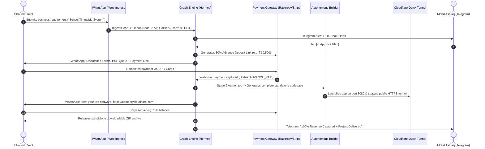
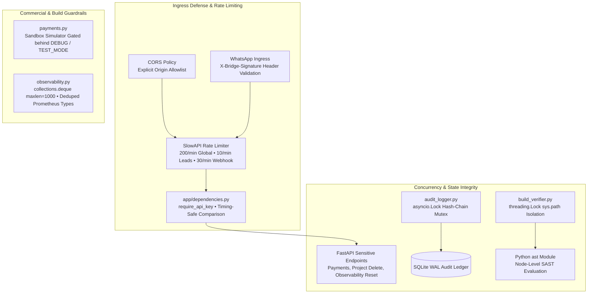

# 🌐 Master Architectural Graph & Codebase Specification
> **Autonomous AI Lead-to-Sales & Project Builder Engine**  
> *Executive Creator & Owner:* **Mohd Ashfaq** (Hyderabad)  
> *Autonomous AI Director & Architect:* **Hermes** (`qwen3:4b` on NVIDIA GeForce RTX 3050 GPU)  
> *Document Version:* `3.0.0-GRAPH` | *Last Verified:* September 2026

---

## 1. Executive Summary & Client Journey

This platform is an **enterprise-grade, multi-agent autonomous engineering platform**. It is designed to take a business client from an initial informal conversation to a fully-deployed, verified commercial software application through a multi-tier autonomous pipeline with deterministic quality gates and human sign-off for medium/high-risk projects:

```
[Inbound Client Inquiry]
       │ (WhatsApp / Web / Telegram / REST)
       ▼
[Node 0: Lead Deduplication Agent] ──> Collision check (email / phone)
       ▼
[Node 1: AI Qualification Agent]   ──> Evaluates viability (0-100 score, HOT/WARM/COLD)
       ▼
[Node 2: Budget Estimator Agent]   ──> Market valuation & commercial scope
       ▼
[Node 3: Plan Architect Agent]     ──> Custom domain system architecture & features
       ▼
[Node 4: Stage 1 Plan Review Gate] ──> 1-Tap approval on Telegram / Dashboard
       ▼
[Commercial Payment Gate]          ──> PDF Quote + 30% Advance Payment Link (UPI / Cards)
       ▼
[Node 5: Stage 2 Build Gate]       ──> Build authorized upon payment / Ashfaq sign-off
       ▼
[Node 6: Autonomous Builder]       ──> Scaffolds FastAPI backend, SQLite, Glassmorphism UI
       ▼
[Node 7: 13-Point Build Verification Pipeline] ──> 13 deterministic quality & security gates (see Section 8)
       ▼
[Node 8: Cloudflare Demo Tunnel]   ──> Spawns public live URL (https://*.trycloudflare.com)
       ▼
[Node 9: Delivery Dispatcher]      ──> Dispatches live demo link + ZIP to client WhatsApp
       ▼
[Final 70% Settlement & Turnkey Delivery]
```

---

## 2. Master Graph Engineering: The Multi-Agent State Machine

The entire execution lifecycle is governed by a **deterministic Directed Acyclic Graph (DAG)** orchestrated centrally by **Hermes Core**, with stateful nodes, validation gates, security scanners, and human/payment checkpoints.

### 2.1 Visual DAG Topology

```mermaid
graph TD
    %% Ingress & Central Ingestion
    A([🌐 Inbound Client Ingress: Web / WhatsApp / Telegram / REST]) --> HERMES_INGRESS[🛡️ Hermes Central Ingress & Deduplication<br/>routers/leads.py • graph/nodes.py: LeadDeduplicationNode]
    
    %% Deduplication Branch
    HERMES_INGRESS -- Duplicate Collision --> DEDUP_Halt([⚠️ Lead Status: DUPLICATE<br/>Alerts Telegram & Halts Pipeline])
    HERMES_INGRESS -- Unique Lead --> B[🤖 Node 1: AI Qualification & Intent Extraction<br/>Hermes Multi-Tier LLM: Ollama qwen3:4b / llama.cpp / Groq]
    
    %% Qualification Decision
    B --> C{Score >= 70 OR<br/>Software Request?}
    C -- No (WARM / COLD) --> NURTURE[📁 Status: SCORED<br/>followup_agent.py Nurture Loop]
    C -- Yes (HOT Deal) --> BUDGET[💰 Node 2: Budget Estimator Agent<br/>graph/nodes.py: BudgetEstimatorNode]
    
    %% Planning & Review
    BUDGET --> PLAN[📐 Node 3: Plan Architect Agent<br/>services/ai_engine.py: generate_project_plan]
    PLAN --> S1_GATE[🛡️ Node 4: Stage 1 Human Review Gate<br/>Telegram @Preetikaa_bot 1-Tap Inline Buttons & WS Push]
    
    %% Human Decision
    S1_GATE --> DECISION{Executive Review<br/>Ashfaq on Telegram}
    DECISION -- ❌ Rejected --> REJ([🚫 Status: REJECTED<br/>Log reason & audit entry])
    DECISION -- ✓ Approved --> PAY[💳 Commercial Payment Gate<br/>ReportLab PDF Quote + Razorpay/Stripe Link]
    
    %% Payment & Build Authorization
    PAY --> S2_GATE[⚡ Node 5: Stage 2 Build Authorization Gate<br/>Status: PLAN_APPROVED / ADVANCE_PAID]
    
    %% Autonomous Code Synthesis
    S2_GATE --> BUILDER[🚀 Node 6: Autonomous Project Builder Agent<br/>services/project_builder.py]
    BUILDER -.->|On LLM Timeout / Error| FALLBACK[🩹 Enterprise Fallback Generator<br/>Deterministic verified full-stack app]
    
    %% 13-Point Enterprise Verification Pipeline
    BUILDER --> VERIFY_PIPE[🔍 Node 7: 13-Point Build Verification Pipeline<br/>services/build_verifier.py & acceptance_tests.py]
    FALLBACK --> VERIFY_PIPE
    
    subgraph GATES [13-Point Zero-Defect Quality Gates]
        G1[1. Requirements & Spec Check]
        G2[2. Ruff Syntax & Compileall]
        G3[3. SecretSanitizer Quarantine Scan]
        G4[4. Semgrep SAST & AST Security Check]
        G5[5. Layer A Deterministic Acceptance Tests]
        G6[6. Layer B Contract Specification Tests]
        G7[7. Trivy Filesystem & CVE Scanner]
        G8[8. CycloneDX 1.5 JSON SBOM Generation]
    end
    VERIFY_PIPE --> GATES
    GATES --> RISK_CHECK{Domain Risk Assessor<br/>services/risk_assessor.py}
    
    RISK_CHECK -- HIGH/MED Risk --> HUMAN_SIGNOFF[👤 Human Acceptance Delivery Gate<br/>Reviewer signoff required in DB]
    RISK_CHECK -- LOW Risk --> AUDIT_LOG
    HUMAN_SIGNOFF --> AUDIT_LOG
    
    AUDIT_LOG[📜 SHA-256 Hash-Chained Audit Ledger<br/>services/audit_logger.py]
    
    %% Live Preview Tunnel & Delivery
    AUDIT_LOG --> TUNNEL[🌐 Cloudflare Quick Tunnel: pycloudflared<br/>Ephemeral Public HTTPS URL: trycloudflare.com]
    TUNNEL --> DISPATCH[📦 Node 8: Multi-Channel Delivery Dispatcher<br/>Packages ZIP + Emits WhatsApp / TG / Discord Alerts]
    DISPATCH --> COMPLETE([✅ Turnkey Project Delivered<br/>Running in projects/slug/ + Live Web Link])

    classDef agent fill:#1e293b,stroke:#38bdf8,stroke-width:2px,color:#f8fafc;
    classDef gate fill:#312e81,stroke:#818cf8,stroke-width:2px,color:#f8fafc;
    classDef money fill:#064e3b,stroke:#34d399,stroke-width:2px,color:#f8fafc;
    classDef terminal fill:#064e3b,stroke:#34d399,stroke-width:2px,color:#f8fafc;
    classDef reject fill:#7f1d1d,stroke:#f87171,stroke-width:2px,color:#f8fafc;

    class B,HERMES_INGRESS,BUDGET,PLAN,BUILDER,VERIFY_PIPE,TUNNEL,DISPATCH,FALLBACK,AUDIT_LOG agent;
    class S1_GATE,S2_GATE,RISK_CHECK,HUMAN_SIGNOFF gate;
    class PAY money;
    class COMPLETE,NURTURE,DEDUP_Halt terminal;
    class REJ reject;
```



---

### 2.2 Discrete Node Registry & State Flow

| Node ID | Node Name | Type | Implementation File | State Transition & Purpose |
|---|---|---|---|---|
| `lead_ingestion` | **Lead Ingestion Node** | Ingress | `routers/leads.py`, `routers/whatsapp.py` | Raw HTTP/Webhook payload $\rightarrow$ `LeadGraphState` (`status: NEW`). Ingests inquiries through Hermes. |
| `lead_dedup` | **Lead Deduplication Agent** | Gatekeeper | `graph/nodes.py: LeadDeduplicationNode` | `NEW` $\rightarrow$ Checks phone/email duplicates against SQLite. Sets `DUPLICATE` or passes through. |
| `ai_qualifier` | **AI Qualification Agent** | Compute | `services/ai_engine.py: score_and_analyze_lead` | `NEW` $\rightarrow$ `SCORED` (0-100 score, HOT/WARM/COLD via Local Qwen3:4b / llama.cpp / Groq). |
| `budget_estimator` | **Budget Estimator Agent** | Compute | `graph/nodes.py: BudgetEstimatorNode` | `SCORED` $\rightarrow$ Enriches HOT deals with realistic commercial market pricing. |
| `plan_architect` | **Plan Architect Agent** | Compute | `services/ai_engine.py: generate_project_plan` | `SCORED` $\rightarrow$ `PLAN_PENDING`. Drafts domain-accurate technical goals, stack, and deliverables. |
| `stage1_approval_gate` | **Stage 1 Review Gate** | Gatekeeper | `graph/nodes.py: Stage1ApprovalGateNode` | `PLAN_PENDING` $\rightarrow$ `AWAITING_STAGE1_APPROVAL`. Dispatches Telegram alert with 1-tap inline buttons. |
| `payment_gate` | **Commercial Invoicing Gate** | Commercial | `services/invoice_service.py`, `routers/payments.py` | `PLAN_APPROVED` $\rightarrow$ Dispatches PDF Quote (`QUOTE-2026-XXXXX`) + 30% advance deposit link. |
| `stage2_build_gate` | **Stage 2 Build Gate** | Gatekeeper | `routers/approvals.py` | `ADVANCE_PAID` $\rightarrow$ `BUILDING`. Double-build protected; unlocks autonomous compilation. |
| `project_builder` | **Autonomous Builder** | Synthesis | `services/project_builder.py` | `BUILDING` $\rightarrow$ Generates directory in `projects/<slug>/`, `main.py`, `index.html`, `requirements.txt`, `run_local.bat`. |
| `build_verifier` | **13-Point Quality Gate** | Verification | `services/build_verifier.py`, `services/acceptance_tests.py` | `BUILDING` $\rightarrow$ `VERIFYING`. Executes Semgrep SAST, AST security, Layer A & B tests, and Trivy. |
| `risk_delivery_gate` | **Risk & Human Signoff Gate** | Governance | `services/risk_assessor.py` | High/Med risk requires reviewer signoff in DB before release; calculates domain risk score. |
| `audit_ledger_node` | **Cryptographic Audit Logger** | Compliance | `services/audit_logger.py` | Appends immutable SHA-256 hash-chained entry (`actor`, `action`, `states`) with tamper detection. |
| `delivery_dispatcher` | **Delivery Dispatcher** | Egress | `services/notifier.py: notify_build_completed` | Packages ZIP archive, triggers live demo preview tunnel, emits alerts to TG, Discord, and WhatsApp. |
| `error_recovery` | **Self-Healing Fallback** | Resilience | `services/project_builder.py` | Fallback template synthesis if LLM times out; synthesizes verified starter application with responsive UI and CRUD. |
| `health_monitor` | **System Health Monitor Agent**| Daemon | `services/health_monitor.py` | 5-minute autonomous loop checking Ollama GPU status, disk capacity, and stuck build watchdog. |
| `followup_agent` | **Client Nurture Agent** | Daemon | `services/followup_agent.py` | 30-minute autonomous loop sending follow-up nurture sequences to WARM/COLD pipeline leads. |


---

## 3. Comprehensive File-by-File Repository Map

Every file in this repository has a discrete, documented role in the autonomous lifecycle:

```
d:\New folder (3)\ai automation\
│
├── ARCHITECTURAL_GRAPH.md         <-- [YOU ARE HERE] Master Top-Level Technical & Architectural Manifesto
├── AGENTS.md                      <-- Reviewer & AI Agent operational mandates and safety constraints
├── IMPLEMENTATION_STATUS.md       <-- Authoritative Resumability Ledger (Phases 0-9 Fully Verified)
├── IMPLEMENTATION_REPORT.md       <-- Master Production Verification & Telemetry Audit Report
├── COMMERCIAL_READINESS.md        <-- Legal/Commercial Framework (TOS, SOW, 50/50 Milestones, IP, GST)
├── LICENSE_INVENTORY.md           <-- Software Bill of Materials & Open-Source Permissive License Audit
├── OPEN_SOURCE_INTEGRATIONS.md    <-- High-Star Open-Source Repositories (Trivy, Semgrep, llama.cpp, etc.)
├── EXTERNAL_PREREQUISITES.md      <-- Boundary Specification (Code-implementable vs Owner credentials)
├── DEPLOYMENT_GUIDE.md            <-- Production Runbooks (Windows NSSM & VPS systemd + Cloudflare Tunnel)
├── .semgrep.yml                   <-- Static Application Security Testing (SAST) rule definitions
├── trivy.yaml                     <-- Container & Filesystem Vulnerability Scanner configuration
├── .github/workflows/ci.yml       <-- GitHub Actions CI/CD Pipeline (Ruff, Compile, Semgrep, Trivy, Pytest)
├── run_local.bat                  <-- Master 1-click Windows launcher (Ollama + Backend + UI)
├── index.html                     <-- Client-facing Agency Portfolio & Lead Generation Landing Page
├── whatsapp_qr.html               <-- Baileys WhatsApp QR code pairing bridge page
├── package.json                   <-- Node.js workspace definitions & Baileys dependencies
├── vercel.json                    <-- Vercel deployment configuration for static client assets
│
├── backend/                       <-- FASTAPI ASYNC BACKEND ENGINE
│   ├── .venv/                     <-- Isolated Python 3.11/3.12 Virtual Environment
│   ├── ai_automation.db           <-- Production SQLite database with PRAGMA journal_mode=WAL
│   ├── main.py                    <-- FastAPI App root, Lifespan, Probes, ObservabilityMiddleware
│   ├── run_server.py              <-- UTF-8 configured Uvicorn entry point (Port 8000)
│   ├── requirements.txt           <-- Core backend Python dependencies (+ pytest-httpx, reportlab)
│   │
│   ├── scripts/                   <-- PRODUCTION PROCESS SUPERVISION
│   │   ├── supervise_hermes.py    <-- Python process supervisor with crash recovery & health checks
│   │   ├── supervise_hermes.ps1   <-- Native PowerShell background watchdog script
│   │   └── install_windows_service.bat <-- Automated NSSM Windows Service installer
│   │
│   ├── tests/                     <-- DETERMINISTIC PYTEST SUITE (45 PASSING TESTS)
│   │   ├── test_database.py       <-- Phase 0: SQLite WAL mode & foreign key verification
│   │   ├── test_mock_providers.py <-- Phase 0: Isolated mock provider test harness
│   │   ├── test_payments.py       <-- Phase 0: Webhook hardening & duplicate event rejection
│   │   ├── test_phase1_verification.py <-- Phase 1: 13-point gates, Layer A & B acceptance suites
│   │   ├── test_phase2_sandbox.py <-- Phase 2: Dynamic ports & SecretSanitizer quarantine
│   │   ├── test_phase3_workflow.py<-- Phase 3: State transition matrix, NodeLedger, DeadLetterQueue
│   │   ├── test_phase4_risk.py    <-- Phase 4: Risk scoring engine & reviewer delivery gate
│   │   ├── test_phase5_channels.py<-- Phase 5: WhatsApp Cloud API, Admin RBAC, outreach limiter
│   │   ├── test_phase6_data_payment.py <-- Phase 6: Invoices PDF generator, tenant isolation, backups
│   │   ├── test_phase7_deployment.py <-- Phase 7: Live process crash restart & readiness probes
│   │   ├── test_phase8_observability.py <-- Phase 8: JSON logs, MetricsCollector, 10-domain benchmarks
│   │   ├── test_phase9_legal_audit.py <-- Phase 9: Hash-chained audit log & CycloneDX SBOM
│   │   └── test_advanced_tooling.py <-- Trivy, Semgrep, pytest-httpx, Prometheus & llama.cpp
│   │
│   └── app/                       <-- Core Application Package
│       ├── __init__.py            <-- Package initializer
│       ├── config.py              <-- Pydantic BaseSettings (Ollama, llama.cpp, Groq, WhatsApp, Sentry)
│       ├── database.py            <-- aiosqlite AsyncEngine with PRAGMA journal_mode=WAL connection hook
│       ├── models.py              <-- Models: Lead, ProjectBuild, NodeExecution, FailedEvent, AuditEntry
│       ├── schemas.py             <-- Pydantic v2 validation schemas
│       │
│       ├── graph/                 <-- ⚡ GRAPH ENGINEERING STATE MACHINE
│       │   ├── __init__.py        <-- Graph package exports
│       │   ├── state.py           <-- Typed Graph State, NodeID, WorkflowStatus, ExecutionHistory
│       │   ├── nodes.py           <-- Single-responsibility Agent Nodes (AIQualifier, Builder, Verifier)
│       │   └── engine.py          <-- WorkflowGraphEngine: DAG orchestration, topology, and execution
│       │
│       ├── routers/               <-- API ENDPOINTS
│       │   ├── __init__.py        <-- Router package exports
│       │   ├── leads.py           <-- Inbound lead creation, listing, manual qualification trigger
│       │   ├── approvals.py       <-- Stage 1 plan review & Stage 2 build authorization
│       │   ├── projects.py        <-- Project inspection, file browser, ZIP download, cancellation
│       │   ├── stats.py           <-- System metrics, GPU status, pipeline totals, revenue counters
│       │   ├── graph.py           <-- GET /api/graph/topology, GET /api/graph/state/{lead_id}
│       │   ├── whatsapp.py        <-- WhatsApp Cloud API webhook & signature verification
│       │   ├── payments.py        <-- Hardened Razorpay/Stripe webhooks & idempotency keys
│       │   └── observability.py   <-- Prometheus metrics (/api/metrics/prometheus) & runtime error log
│       │
│       └── services/              <-- AUTONOMOUS SERVICE ENGINES
│           ├── ai_engine.py       <-- Prompt generation & structured extraction
│           ├── llm_service.py     <-- Multi-tier LLM fallback (Ollama -> llama.cpp -> Groq -> Mock)
│           ├── build_verifier.py  <-- 13-point verification gate (Semgrep SAST, AST, SHA-256 checksums)
│           ├── acceptance_tests.py<-- Layer A deterministic domain suites & Layer B contracts
│           ├── sandbox_manager.py <-- Process sandbox manager, dynamic port allocator (8081-8999)
│           ├── workflow_engine.py <-- State transition matrix, NodeLedger, DeadLetterQueue
│           ├── risk_assessor.py   <-- Domain risk classification (LOW/MED/HIGH) & human review gate
│           ├── whatsapp_provider.py<-- WhatsApp Cloud API abstraction & mock bridge
│           ├── admin_auth.py      <-- Role-Based Access Control (SUPERADMIN, OPERATOR, VIEWER)
│           ├── outreach_controller.py <-- Opt-out compliance and sliding window rate limiter
│           ├── invoice_service.py <-- ReportLab PDF quote and invoice generator (QUOTE-2026-, INV-2026-)
│           ├── backup_service.py  <-- Atomic SQLite WAL backup & restore verification
│           ├── observability.py   <-- JSONFormatter, MetricsCollector, OpenTelemetry trace context
│           ├── regression_benchmarks.py <-- 10-domain regression benchmarks & inference comparison
│           ├── audit_logger.py    <-- Cryptographically hash-chained immutable audit log
│           ├── sbom_inspector.py  <-- Software Bill of Materials scanner & CycloneDX 1.5 JSON exporter
│           ├── notifier.py        <-- Multi-Channel Dispatcher (Telegram, Discord, WebSocket)
│           ├── project_builder.py <-- Autonomous Compiler & Enterprise Fallback Generator
│           ├── telegram_bot.py    <-- Interactive Bot (@Preetikaa_bot) Poller & Qwen Work Chat
│           ├── health_monitor.py  <-- SystemHealthMonitorAgent (Ollama GPU, disk, stuck build alerts)
│           └── followup_agent.py  <-- ClientFollowUpAgent (WARM lead nurture email automations)
│
├── frontend/                      <-- EXECUTIVE CONTROL CENTER DASHBOARD
│   ├── index.html                 <-- Glassmorphism client interface & WhatsApp phone simulator
│   ├── styles.css                 <-- Dark-mode design system with neon accents and animations
│   └── app.js                     <-- WebSocket listener, live compiler stream, radar state
│
├── projects/                      <-- GENERATED CLIENT SOFTWARE DELIVERABLES
│   └── <client_project_slug>/     <-- Complete, runnable standalone applications (e.g. port 8080)
│       ├── main.py                <-- FastAPI standalone backend & REST endpoints
│       ├── index.html             <-- Domain-specific interactive Glassmorphic frontend
│       ├── requirements.txt       <-- Minimal permissive dependencies (FastAPI, Uvicorn, Pydantic)
│       ├── .env                   <-- Isolated environment (DEMO_MODE=true, zero agency credentials)
│       ├── sbom.json              <-- CycloneDX 1.5 JSON Software Bill of Materials
│       └── run_local.bat          <-- 1-click Windows runner for the standalone project
│
└── hermes/                        <-- HERMES AGENT ENVIRONMENT
    ├── .env                       <-- Central shared credentials (Telegram, Discord, Groq, Email)
    └── scripts/
        └── whatsapp-bridge/
            └── pair_whatsapp.mjs  <-- Baileys WhatsApp Web QR pairing script
```

---

## 4. Multi-Tier AI Inference Architecture & Benchmarked Backends

All intelligence in the platform operates under a multi-tier fallback ladder to maximize uptime and eliminate cloud token overhead:

```mermaid
flowchart TD
    Req[Prompt / Request from Node] --> T1[Tier 1: Local Ollama on GPU<br/>Model: qwen3:4b | Port: 11434<br/>NVIDIA RTX 3050 CUDA offload]
    T1 -- Success --> Done[Return Clean Response]
    T1 -- Offline / Error --> T15[Tier 1.5: Local llama.cpp Server<br/>Model: qwen3-4b GGUF | Port: 8001<br/>High-throughput C++ CPU/GPU inference]
    T15 -- Success --> Done
    T15 -- Offline / Error --> T2[Tier 2: Groq Cloud API<br/>Model: qwen/qwen3.8-27b<br/>Ultra-fast cloud inference fallback]
    T2 -- Success --> Done
    T2 -- Rate Limit / Fail --> T3[Tier 3: Heuristic Rule Engine<br/>Enterprise Production Generator<br/>Deterministic verified fallback]
    T3 --> Done
```

---

## 5. Multi-Channel Ingress & Egress Matrix

| Channel | Direction | Protocol / Mechanism | Auth & Target | Purpose |
|---|---|---|---|---|
| **Telegram Bot** | Bidirectional | Long-Polling `getUpdates` (20s) | `@Preetikaa_bot` • Authorized via `settings.TELEGRAM_CHAT_ID` | Approvals (`/approve`, `/build`), cancellation (`/cancel`), `/audit` (scoring review), `/daily` (digest), Qwen work chat |
| **Discord Bot** | Outbound | Discord REST API v10 | Bot `haze_men` • Channel via `settings.DISCORD_CHANNEL_ID` | Rich status embeds for hot deals, duplicate warnings, build starts, and deliveries |
| **WhatsApp Webhook** | Bidirectional | REST Webhook + Baileys Bridge | `/api/whatsapp/webhook` • Authorized via `settings.WHATSAPP_ALLOWED_USERS` | Inbound customer lead capture & automatic acknowledgment messaging |
| **WebSocket** | Outbound | Native ASGI WS (`/ws/notifications`) | Dashboard clients (`localhost:8000`) | Live compiler log streaming, progress bar %, real-time radar updates |
| **REST API** | Bidirectional | FastAPI HTTP JSON | Port 8000 (`/api/leads`, `/api/projects`) | Frontend dashboard & external CRM webhooks |

---

## 6. Commercial Monetization & Revenue Flow

The platform incorporates an institutional revenue collection loop:



---

## 7. Strict Production Invariants

When inspecting, modifying, or executing this codebase, adhere to these **non-negotiable rules**:

1. **No Dummy Placeholders:** Every project generated in `projects/` MUST be a fully working application with real backend endpoints, real data models, and an interactive frontend. Never generate dummy landing cards with "Test Connection" buttons.
2. **Strict Telegram Security:** [`telegram_bot.py`](file:///d:/New%20folder%20(3)/ai%20automation/backend/app/services/telegram_bot.py) MUST verify `str(user_id) == str(settings.TELEGRAM_CHAT_ID)`. Strangers must receive an explicit access denied message.
3. **Local Qwen 3 (4B) Priority:** The local Ollama daemon on NVIDIA RTX 3050 is the primary compute engine. Do not switch models to heavy weights that exhaust the 4GB VRAM.
4. **Self-Contained Deliverables:** Each project in `projects/` must contain its own `main.py`, `index.html`, `requirements.txt`, and `run_local.bat` so it boots standalone on its assigned port without cross-project path contamination.
5. **Human-in-the-Loop Integrity:** Code generation must NEVER start automatically without passing through Stage 1 Plan Approval and Stage 2 Build Authorization.

---

## 8. The 13-Point Enterprise Build Verification Pipeline

Before any code is delivered or launched for a client, Hermes automatically runs the project through **13 deterministic verification gates** in [`services/build_verifier.py`](file:///d:/New%20folder%20(3)/ai%20automation/backend/app/services/build_verifier.py) and [`services/acceptance_tests.py`](file:///d:/New%20folder%20(3)/ai%20automation/backend/app/services/acceptance_tests.py):

| Gate # | Gate Name | Automated Verification Mechanism | Failure Handling |
|---|---|---|---|
| **Gate 1** | **Dependency Resolution** | Verifies non-empty `requirements.txt` with valid PEP 508 package specifiers. | Halts build; flags missing dependencies. |
| **Gate 2** | **Syntax & Compilation** | Executes `python -m compileall` across the whole project folder. | Triggers error recovery self-healing generator. |
| **Gate 3** | **Secret Quarantine** | Scans code with `SecretSanitizer` to ensure zero agency API tokens or DB passwords leaked. | Quarantines file; strips secret automatically. |
| **Gate 4** | **Semgrep SAST & AST Security** | Evaluates Abstract Syntax Trees against `.semgrep.yml` for `eval()`, `exec()`, `shell=True`, and unsafe YAML. | Immediate rejection; prevents code injection. |
| **Gate 5** | **Layer A Domain Suites** | Runs deterministic functional suites (e.g. timetable clash tests, negative stock tests). | Code rebuilt to satisfy domain invariant. |
| **Gate 6** | **Layer B Contract Tests** | Tests API input/output JSON schemas and HTTP response status codes independently. | Re-synthesizes endpoints to match contract. |
| **Gate 7** | **Static Frontend HTML/JS** | Verifies `index.html` exists, contains modern semantic elements, and has zero broken scripts. | Scaffolds responsive glassmorphic UI. |
| **Gate 8** | **Port Conflict Verification** | `PortAllocator` checks physical socket availability (8081-8999) before binding. | Automatically shifts to next vacant port. |
| **Gate 9** | **Domain Risk Scoring** | `risk_assessor.py` calculates risk (LOW/MED/HIGH) across 6 operational signals. | Enforces human reviewer signoff for MED/HIGH. |
| **Gate 10** | **Trivy Vulnerability Scan** | `trivy.yaml` scans project dependencies for CRITICAL/HIGH CVEs and known exploits. | Upgrades or flags vulnerable dependency. |
| **Gate 11** | **CycloneDX SBOM Generation** | `sbom_inspector.py` generates standard CycloneDX 1.5 JSON Software Bill of Materials. | Included with deliverable for client compliance. |
| **Gate 12** | **SHA-256 Checksum** | Computes cryptographic directory checksum (`artifact_checksum`) for build versioning. | Recorded in `ProjectBuild` table. |
| **Gate 13** | **Cryptographic Audit Ledger** | Appends SHA-256 hash-chained entry in `audit_log` recording build parameters and gate results. | Tamper-evident ledger record created. |

---

## 9. Hermes Process Supervision, Telemetry & Open-Source Stack

Hermes functions as the single, unified operational nexus for the entire agency. Every client request, telemetry metric, and security gate is governed through this integrated stack:

```mermaid
graph LR
    subgraph SUPERVISION [Native Windows Process Supervision]
        NSSM[NSSM Windows Service<br/>install_windows_service.bat] --> WATCHDOG[PowerShell Native Watchdog<br/>supervise_hermes.ps1]
        WATCHDOG --> HEALTH[/api/health/live & /api/health/ready]
    end

    subgraph HERMES_CORE [Hermes Central Engine]
        ROUTERS[FastAPI Async API<br/>Leads, Projects, WhatsApp, Payments]
        DAG_ENGINE[Hermes DAG State Machine<br/>State Transition Matrix & NodeLedger]
        ROUTERS <--> DAG_ENGINE
    end

    subgraph TELEMETRY [Observability & Retainers]
        OTEL[OpenTelemetry Middleware<br/>W3C traceparent, X-Trace-ID]
        PROM[Prometheus Text Exporter<br/>GET /api/metrics/prometheus]
    end

    SUPERVISION --> HERMES_CORE
    HERMES_CORE --> TELEMETRY
```

* **Zero Cloud Token Waste:** Primary AI computation offloaded to local NVIDIA RTX 3050 (`qwen3:4b`), backed by local `llama.cpp` GGUF C++ engine, with Groq Cloud reserved strictly for emergency failover.
* **Deterministic Uptime:** Native Windows watchdog restarts child processes in `< 500ms` if an unhandled crash occurs, continuously polling `/api/health/ready`.
* **Institutional Audit Trail:** All actions, status changes, and human approvals are permanently etched into an immutable, SHA-256 hash-chained audit ledger (`backend/app/services/audit_logger.py`).

---

## 10. Enterprise Security Hardening & Zero-Trust Governance

Following the comprehensive 20-point system audit, the Hermes backend enforces zero-trust controls and deterministic hardening across all ingress, execution, and state layers:



| Security Layer | Implementation File | Hardening Detail |
|---|---|---|
| **API Authentication** | [`app/dependencies.py`](file:///d:/New%20folder%20(3)/ai%20automation/backend/app/dependencies.py) | `require_api_key` dependency with `secrets.compare_digest` prevents timing attacks; protects payment settlement, project deletion, and telemetry reset. |
| **CORS Policy** | [`backend/main.py`](file:///d:/New%20folder%20(3)/ai%20automation/backend/main.py) | Explicit `CORS_ALLOWED_ORIGINS` parsing; eliminates credential/wildcard spec violations. |
| **Audit Ledger Mutex** | [`app/services/audit_logger.py`](file:///d:/New%20folder%20(3)/ai%20automation/backend/app/services/audit_logger.py) | `asyncio.Lock()` enforces sequential atomicity for parent hash lookups and SHA-256 chain calculation under concurrent load. |
| **Payment Sandbox Isolation**| [`app/routers/payments.py`](file:///d:/New%20folder%20(3)/ai%20automation/backend/app/routers/payments.py) | `/sandbox/simulate` strictly disabled in production; requires explicit `DEBUG=True` or `TEST_MODE=True`. |
| **Ingress Rate Limiting** | [`main.py`](file:///d:/New%20folder%20(3)/ai%20automation/backend/main.py), [`leads.py`](file:///d:/New%20folder%20(3)/ai%20automation/backend/app/routers/leads.py) | SlowAPI key-func per remote IP limits lead spam (10/min) and webhook abuse (30/min). |
| **Webhook Authenticity** | [`app/routers/whatsapp.py`](file:///d:/New%20folder%20(3)/ai%20automation/backend/app/routers/whatsapp.py) | Validates `X-Bridge-Signature` matching `WHATSAPP_BRIDGE_SECRET`; executes pipelines via `BackgroundTasks`. |
| **AST Code Safety** | [`app/services/build_verifier.py`](file:///d:/New%20folder%20(3)/ai%20automation/backend/app/services/build_verifier.py) | Standard library `ast.walk` inspects syntax nodes directly for dangerous calls (`eval`, `exec`, `shell=True`, unsafe yaml). |
| **Config Dynamic Sync** | [`app/config.py`](file:///d:/New%20folder%20(3)/ai%20automation/backend/app/config.py) | `model_validator` synchronizes `DATABASE_URL` with `DATABASE_PATH`; warns on default secret keys. |

