# 🗺️ Hermes Agent — Codebase Graph
> **Agent Navigation Map**: Read this file to instantly know which file to edit for any task.
> Every node links to its source. Every edge shows the dependency direction.

---

## 1. Top-Level Turn Loop (How Every Message is Processed)

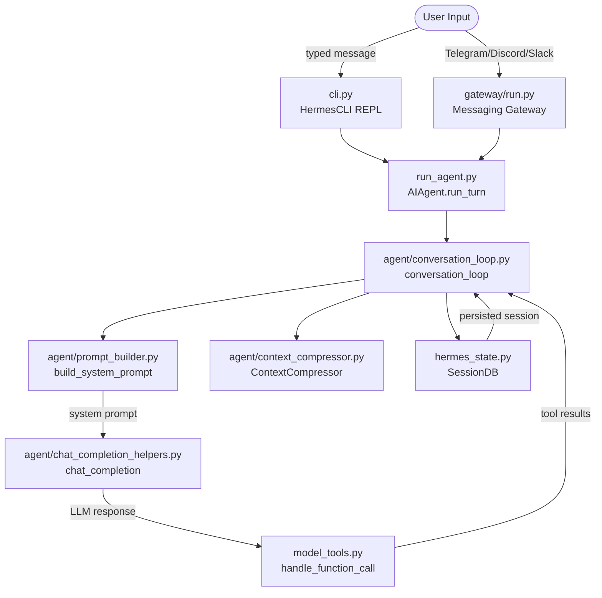

---

## 2. System Prompt Assembly

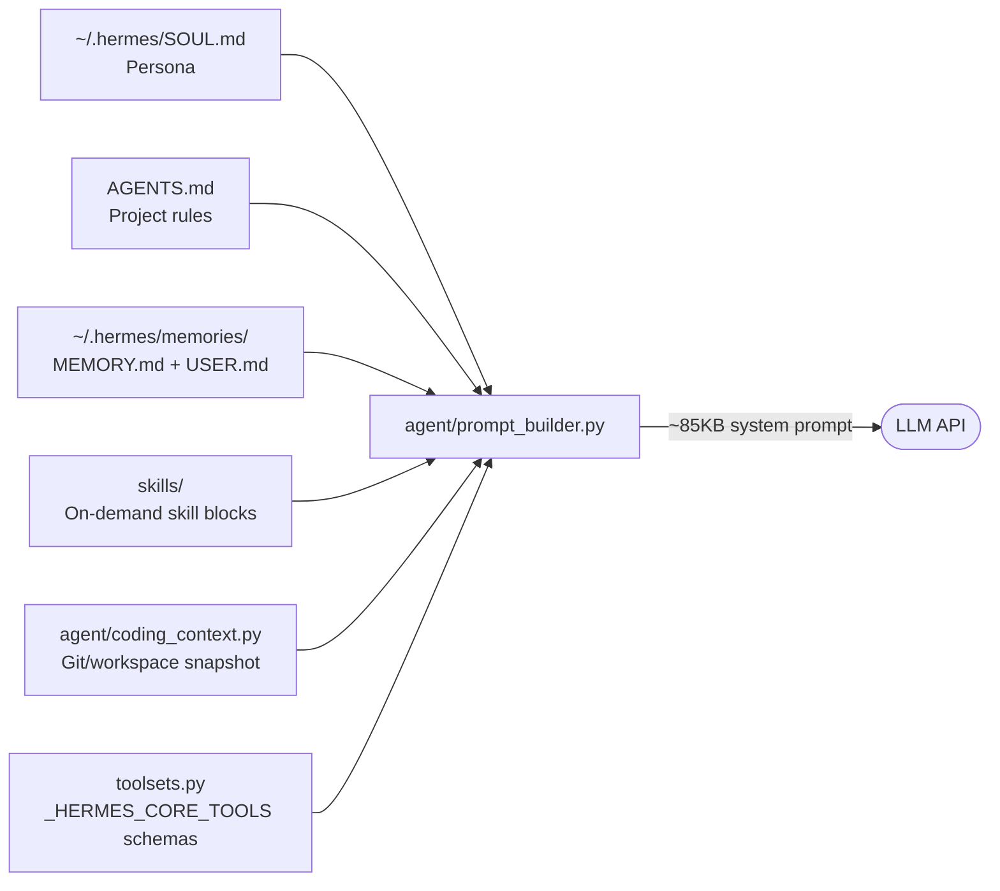

**To change agent persona** → edit `~/.hermes/SOUL.md`
**To change tool schemas** → edit `toolsets.py` or tool file in `tools/`
**To change workspace context** → edit `agent/coding_context.py`

---

## 3. Provider Resolution Chain

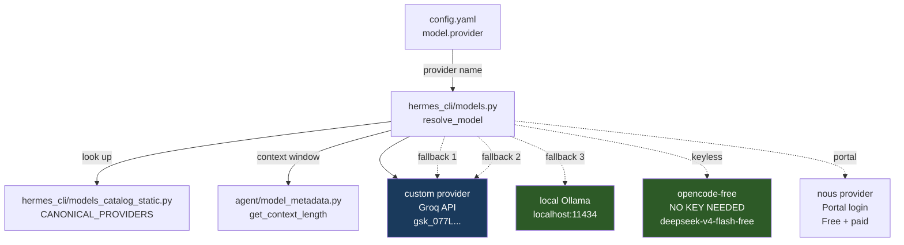

**To change primary model** → edit `config.yaml` → `model.default`
**To add a provider** → edit `hermes_cli/models_catalog_static.py`
**To fix model metadata/context** → edit `agent/model_metadata.py`

---

## 4. Tool Registry & Discovery

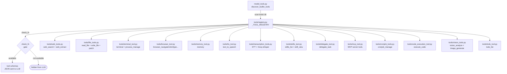

---

## 5. Tool → File Mapping (Edit Guide)

```mermaid
flowchart LR
    subgraph WEB_TOOLS["Web & Search"]
        WT[web_search\nweb_extract]
        WF[tools/web_tools.py\ntools/web_tools_extract.py]
        WBCK[web backend\nconfig.yaml web.backend]
        WT --> WF --> WBCK
    end

    subgraph FILE_TOOLS["File Operations"]
        FT[read_file\nwrite_file\npatch\nsearch_files]
        FF[tools/file_tools.py\ntools/file_operations.py\ntools/patch_parser.py]
        FT --> FF
    end

    subgraph BROWSER_TOOLS["Browser Automation"]
        BT[browser_navigate\nbrowser_click\nbrowser_type\nbrowser_snapshot]
        BF[tools/browser_tool.py\ntools/browser_tool_session.py\ntools/browser_tool_cdp.py]
        BT --> BF
    end

    subgraph MEMORY_TOOLS["Memory & Session"]
        MT[memory\nsession_search\ntodo_list]
        MF[tools/memory_tool.py\ntools/session_search_tool.py\ntools/todo_tool.py]
        MT --> MF
    end

    subgraph VOICE_TOOLS["Voice / Audio"]
        VT[text_to_speech\nSTT]
        VF[tools/tts_tool.py\ntools/tts_tool_local.py\ntools/transcription_tools.py]
        VT --> VF
    end

    subgraph TERMINAL_TOOLS["Terminal & Code"]
        TT[terminal\nexecute_code\nprocess_manage]
        TF[tools/terminal_tool.py\ntools/code_execution_tool.py\ntools/process_registry.py]
        TT --> TF
    end

    subgraph AGENT_TOOLS["Agent & Skills"]
        AT[delegate_task\nskills_list\nskill_view\ncronjob_manage]
        AF[tools/delegate_tool.py\ntools/skills_tool.py\ntools/cronjob_tools.py]
        AT --> AF
    end
```

---

## 6. Configuration Loading Chain

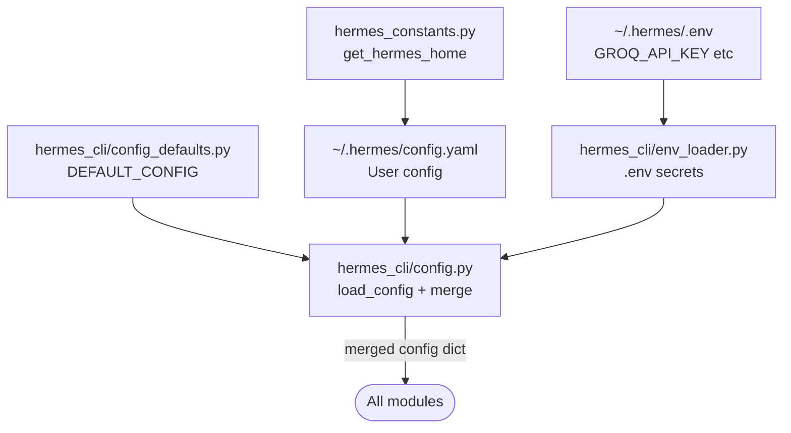

**To change a default setting** → edit `hermes_cli/config_defaults.py`
**To change your live settings** → edit `~/.hermes/config.yaml`
**To add a secret key** → edit `~/.hermes/.env`

---

## 7. Subscription Gate Bypass Map

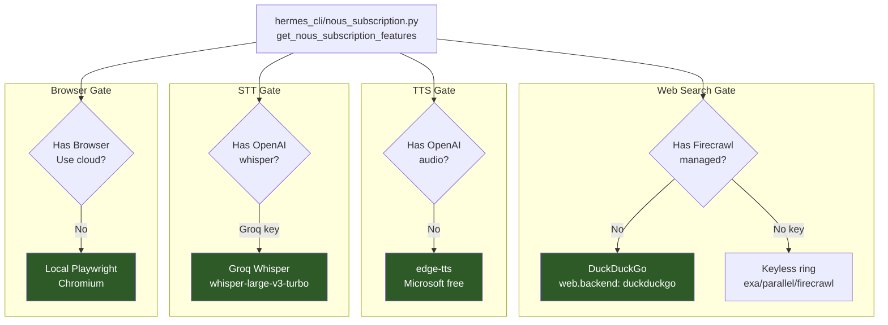

---

## 8. Memory & Compression Flow

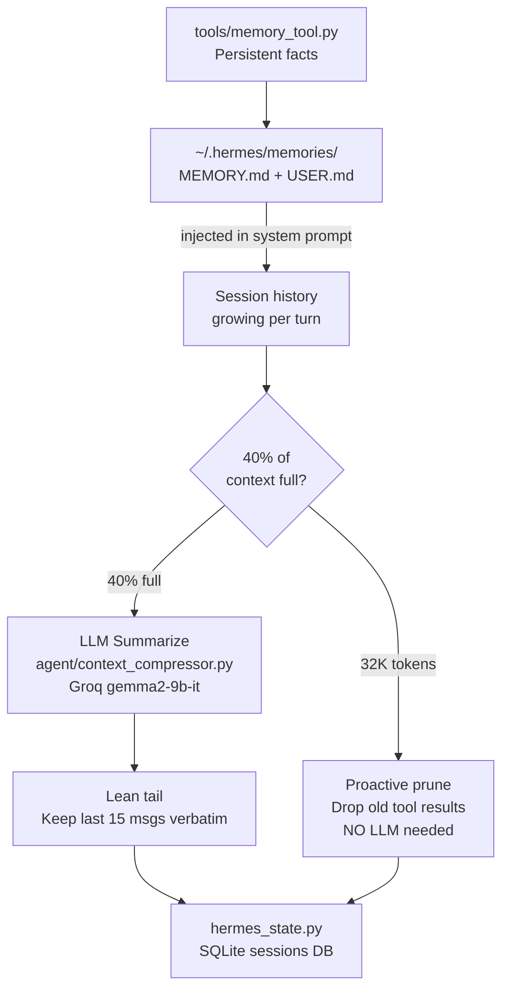

---

## 9. Skills System

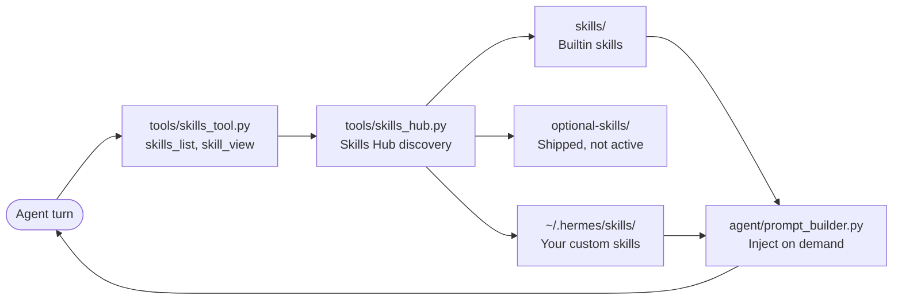

**To create a skill** → create `skills/<category>/<name>/SKILL.md`
**To install a skill from hub** → `hermes skills install <name>`

---

## 10. Gateway / Messaging Platform

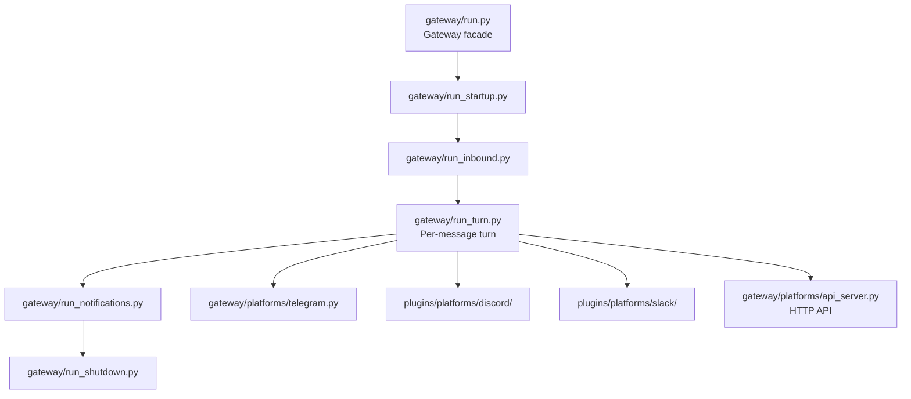

---

## 11. Quick Edit Guide — What File for What Task

| Task | File(s) to edit |
|------|----------------|
| Change AI model | `~/.hermes/config.yaml` → `model.default` |
| Add API key | `~/.hermes/.env` |
| Change agent persona/behavior | `~/.hermes/SOUL.md` |
| Fix web search | `tools/web_tools.py` + `config.yaml web.backend` |
| Fix browser | `tools/browser_tool.py` + `tools/browser_tool_session.py` |
| Fix TTS | `tools/tts_tool.py` + `tools/tts_tool_local.py` (edge-tts) |
| Fix STT | `tools/transcription_tools.py` + `tools/transcription_cloud.py` |
| Fix file read/write | `tools/file_tools.py` + `tools/file_operations.py` |
| Fix terminal | `tools/terminal_tool.py` |
| Add a new tool | New file in `tools/`, register in `tools/registry.py` |
| Change compression | `config.yaml compression.*` + `agent/context_compressor.py` |
| Change system prompt | `agent/prompt_builder.py` |
| Fix provider/model | `hermes_cli/models.py` + `hermes_cli/models_catalog_static.py` |
| Add a platform | `gateway/platforms/<name>.py` |
| Change default config | `hermes_cli/config_defaults.py` |
| Fix cron jobs | `cron/scheduler.py` + `cron/jobs.py` |
| Fix skills | `tools/skills_tool.py` + `tools/skills_hub.py` |
| Fix memory | `tools/memory_tool.py` + `tools/memory_tool_store.py` |
| Fix subagent/delegate | `tools/delegate_tool.py` + `tools/async_delegation.py` |
| Fix MCP servers | `tools/mcp_tool.py` + `tools/mcp_tool_lifecycle.py` |
| Change session DB | `hermes_state.py` + siblings `hermes_state_*.py` |

---

## 12. Free-Tier Component Map (Our Setup)

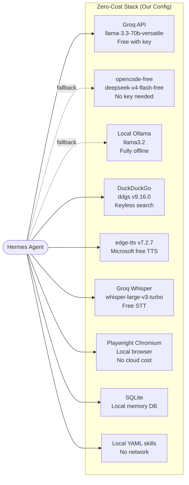

---

## 13. File Size Reference (Largest = Most Complex)

| File | Size | Role |
|------|------|------|
| `plugins/platforms/discord/adapter.py` | 360 KB | Discord platform adapter |
| `plugins/platforms/slack/adapter.py` | 349 KB | Slack platform adapter |
| `gateway/run.py` | 291 KB | Gateway facade (15 siblings) |
| `agent/context_compressor.py` | 283 KB | Context compression engine |
| `agent/conversation_compression.py` | 220 KB | Conversation compression |
| `gateway/platforms/api_server.py` | 219 KB | HTTP API server |
| `cli.py` | 216 KB | Main CLI (12 mixin siblings) |
| `hermes_cli/config_defaults.py` | 190 KB | All default config values |
| `agent/agent_runtime_helpers.py` | 178 KB | Agent runtime utilities |
| `hermes_cli/config.py` | 176 KB | Config load/merge/validate |
| `agent/prompt_builder.py` | 99 KB | System prompt assembly |
| `tools/file_operations.py` | 77 KB | File read/write/patch |
| `tools/terminal_tool.py` | ~60 KB | Terminal execution |
| `tools/browser_tool.py` | ~50 KB | Browser automation |

> **Facade + siblings pattern**: Every large file is a facade. Siblings are `<stem>_<topic>.py`.
> Find code by topic: `grep -rn "def funcname" tools/terminal_tool*.py`

---

*Generated: 2026-09-14 | Read brain.md for the complete setup guide.*
